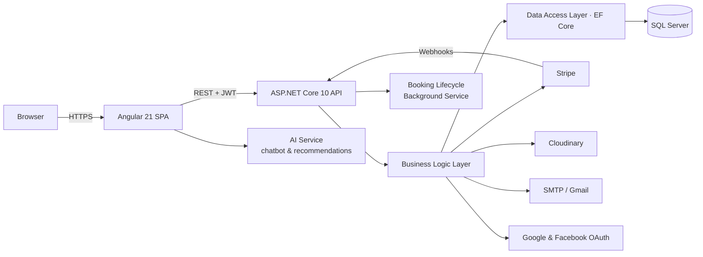

# SmartStay — Vacation Rental Platform

<p align="center">
  
</p>

<p align="center">
  <strong>Airbnb-style booking platform</strong> — guest booking, host listing management and a full admin back office.
</p>

<p align="center">
  <a href="https://smartstay-1.runasp.net"></a>
  
  
  
  
  
</p>

**Live API & Swagger UI:** <https://smartstay-1.runasp.net>

---

## Overview

SmartStay covers the full short-term rental lifecycle. Guests search, book and pay for stays; hosts apply to become hosts, publish and manage their properties; and administrators moderate listings, users, payments and support tickets from a dedicated dashboard.

The project is split into an Angular single-page application and a layered ASP.NET Core API, with third-party integrations for payments, media storage, e-mail and social sign-in.

## Features

### Guest

| Area | Capabilities |
| --- | --- |
| Discovery | Destination search, date-based availability, listing filters, property pages with gallery, amenities, map and reviews |
| Booking | Booking widget, extra services, Stripe checkout, booking confirmation |
| Account | E-mail OTP sign-in, Google and Facebook sign-in, profile management, wishlist, bookings, reviews, support tickets, notifications |
| AI | Chatbot assistant and nearby-place recommendations |

### Host

| Area | Capabilities |
| --- | --- |
| Onboarding | Multi-step host application with identity-document upload and admin verification |
| Listings | Create and edit properties, images, amenities, availability and verification documents |
| Operations | Host dashboard, booking management, guest messaging |
| Earnings | Payout tracking and status |

### Administrator

| Area | Capabilities |
| --- | --- |
| Users | Search, restrict and deactivate accounts |
| Listings | Property and host-application verification |
| Bookings | Booking management, refunds, payout hold / release / block |
| Finance | Revenue dashboard, transaction history, payout control |
| Moderation | Review moderation, support-ticket handling |
| Audit | Immutable admin action log |

## Architecture



**Backend — three layers**

- `SmartStay.Api` — controllers, authentication wiring, middleware, background services, Swagger.
- `SmartStayBLL` — services, DTOs, integrations (Stripe, Cloudinary, social auth), business rules.
- `SmartStayDAL` — EF Core entities, configurations, migrations, seed data.

**Key flows**

- **Authentication** — ASP.NET Core Identity, e-mail OTP verification, JWT access tokens with rotating refresh tokens, role-based authorization (`Guest`, `Host`, `Admin`).
- **Payments** — Stripe PaymentIntents for checkout, signed webhooks for confirmation and refunds, and an idempotent webhook-event store.
- **Booking lifecycle** — a hosted background service advances bookings (confirmation, completion, expiry) on a configurable interval.
- **Notifications** — EF Core interceptors generate user notifications in the same transaction as the domain state change.

## Tech Stack

| Layer | Technology |
| --- | --- |
| Front end | Angular 21 (standalone components, signals), TypeScript, Bootstrap 5, Angular Material, ApexCharts |
| Back end | .NET 10, ASP.NET Core Web API, ASP.NET Core Identity, EF Core 10 |
| Database | SQL Server |
| Payments | Stripe (PaymentIntents, webhooks, refunds, payouts) |
| Media | Cloudinary |
| Auth | JWT + refresh tokens, e-mail OTP, Google OAuth, Facebook Login |
| Docs | Swagger / OpenAPI |
| Tooling | npm, dotnet CLI, EF Core migrations, Prettier |

## Repository Structure

```text
.
├── backend/
│   ├── SmartStay.Api/          # Web API: controllers, middleware, configuration
│   ├── SmartStayBLL/           # Business logic, DTOs, external integrations
│   ├── SmartStayDAL/           # EF Core entities, configurations, migrations
│   └── SmartStay.slnx
└── frontend/
    ├── src/app/Core/           # guards, interceptors
    ├── src/app/Features/       # guest, host and admin feature areas
    ├── src/app/Shared/         # shared components and services
    ├── src/environments/       # API URL and Stripe publishable key
    └── public/                 # static assets
```

## Getting Started

### Prerequisites

- .NET 10 SDK
- Node.js 20+ and npm
- SQL Server (local or hosted)
- Stripe, Cloudinary, SMTP and OAuth credentials (only needed for those features)

### Backend

`backend/SmartStay.Api/appsettings.json` ships with placeholder values only. Supply real configuration through [user secrets](https://learn.microsoft.com/aspnet/core/security/app-secrets) locally and environment variables in production.

```bash
cd backend/SmartStay.Api

dotnet tool restore

dotnet user-secrets set "ConnectionStrings:DefaultConnection" "Server=localhost;Database=SmartStay;User Id=sa;Password=CHANGE_ME;TrustServerCertificate=True"
dotnet user-secrets set "JwtSettings:Key" "<random 32+ byte string>"
dotnet user-secrets set "OtpSettings:HashKey" "<random 32+ byte string>"

dotnet user-secrets set "Stripe:SecretKey" "sk_test_..."
dotnet user-secrets set "Stripe:PublishableKey" "pk_test_..."
dotnet user-secrets set "Stripe:WebhookSecret" "whsec_..."

dotnet user-secrets set "Cloudinary:CloudName" "..."
dotnet user-secrets set "Cloudinary:ApiKey" "..."
dotnet user-secrets set "Cloudinary:ApiSecret" "..."

dotnet user-secrets set "SmtpSettings:Username" "..."
dotnet user-secrets set "SmtpSettings:Password" "..."

dotnet user-secrets set "Authentication:Google:ClientId" "..."
dotnet user-secrets set "Authentication:Facebook:AppId" "..."
dotnet user-secrets set "Authentication:Facebook:AppSecret" "..."

dotnet ef database update --project ../SmartStayDAL
dotnet run
```

Swagger UI is served at the application root (for example `http://localhost:5000`).

### Frontend

```bash
cd frontend
npm ci
npm start
```

The app runs on <http://localhost:4200> and talks to the API configured in `src/environments/environment.ts`.

## Security

- No credentials are committed. `appsettings.json` contains placeholders; real values live in user secrets or environment variables.
- Passwords are hashed by ASP.NET Core Identity.
- JWT access tokens are short-lived and paired with rotating refresh tokens; e-mail addresses are verified by OTP.
- Stripe webhook payloads are verified by signature and de-duplicated by event id.
- Global exception handling returns RFC 7807 `ProblemDetails` responses.
- Administrative actions are written to an audit log.

## Team

Built as a collaborative graduation project at the Information Technology Institute (ITI).

- Tamer Gamal
- Fatima Ashraf
- Abeer Wael
- Ahmed Ashraf
- Ibrahim Elsaid
- Mohamed Amr Mandor

## License

Released under the [MIT License](LICENSE).
